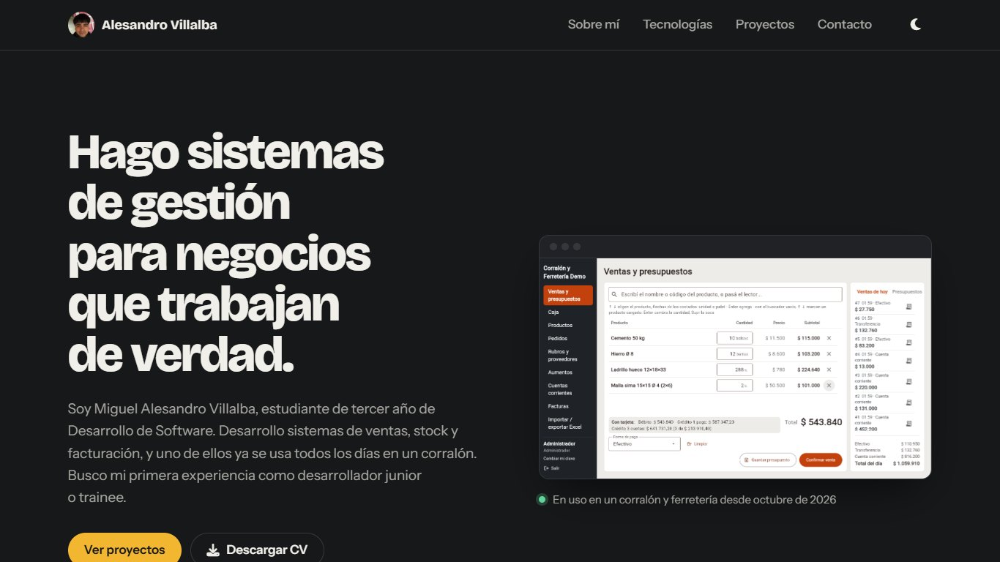
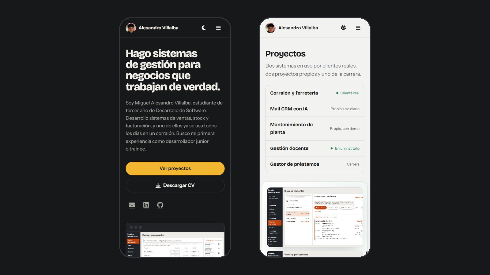

# Portfolio — Miguel Alesandro Villalba

Portfolio personal donde presento mis proyectos y las tecnologías con las que trabajo.

🔗 **Sitio:** https://alesandrovi.github.io/portafolio/





## Características

- Diseño responsive: en el celular las funciones de cada proyecto se pliegan y las capturas se deslizan con el dedo.
- Modo claro y oscuro (oscuro por defecto) con paleta grafito y ámbar; la elección se recuerda en el navegador.
- Secciones de presentación, tecnologías, proyectos (con índice para saltar a cada uno) y contacto.
- Visor de capturas: al tocar una imagen de un proyecto se abre ampliada, con anterior y siguiente (se cierra con la X, tocando afuera o con `Escape`).
- Animaciones sobrias: entrada del inicio, proyectos que entran de costado al scrollear y cambio de tema en círculo.
- Navegable con teclado y respeta la preferencia de reducir animaciones.
- Imagen de vista previa para cuando se comparte el enlace (WhatsApp, LinkedIn).
- Sin frameworks ni proceso de compilación: HTML, CSS y JavaScript puros.

## Tecnologías

- HTML5
- CSS3 (Flexbox, Grid, media queries, variables)
- JavaScript
- [Font Awesome](https://fontawesome.com/) y [Devicon](https://devicon.dev/) para los íconos

## Estructura

```
├── index.html      # Página principal
├── style.css       # Estilos
├── JS/script.js    # Menú, visor de capturas, modo claro/oscuro, animaciones y año del pie
└── img/            # Foto de perfil, capturas de proyectos y favicon
```

## Verlo localmente

No necesita instalación. Se puede abrir `index.html` directamente en el navegador, o usar la extensión **Live Server** de Visual Studio Code.

## Contacto

- Email: [alesandrovill@gmail.com](mailto:alesandrovill@gmail.com)
- LinkedIn: [Alesandro Villalba](https://www.linkedin.com/in/alesandro-villalba-bb6508367)
- GitHub: [@AlesandroVi](https://github.com/AlesandroVi)
